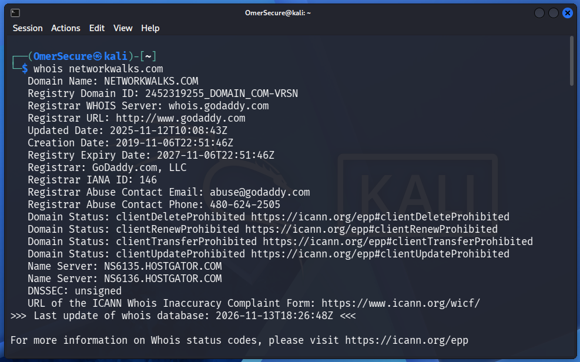
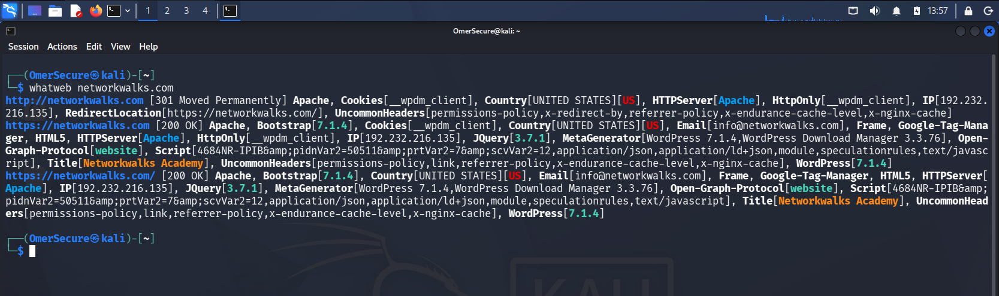
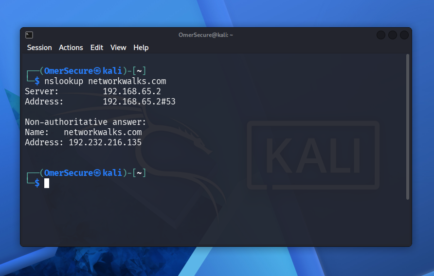
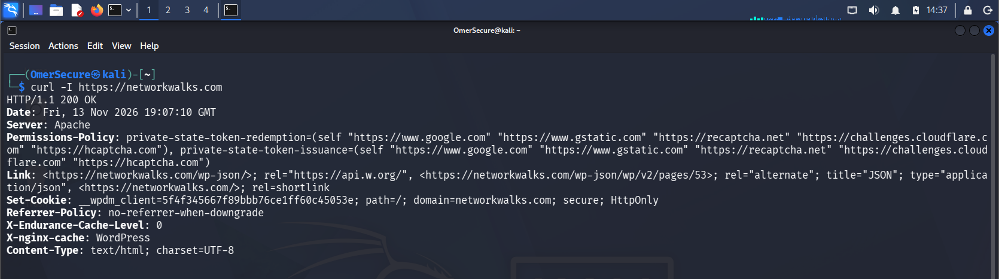
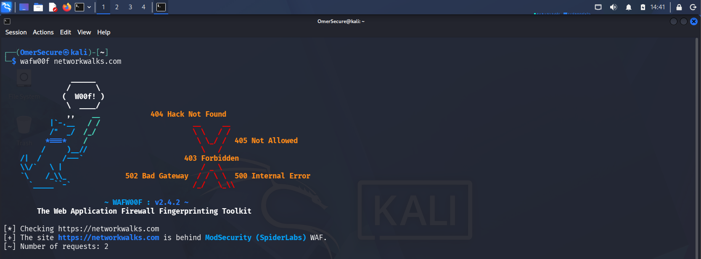
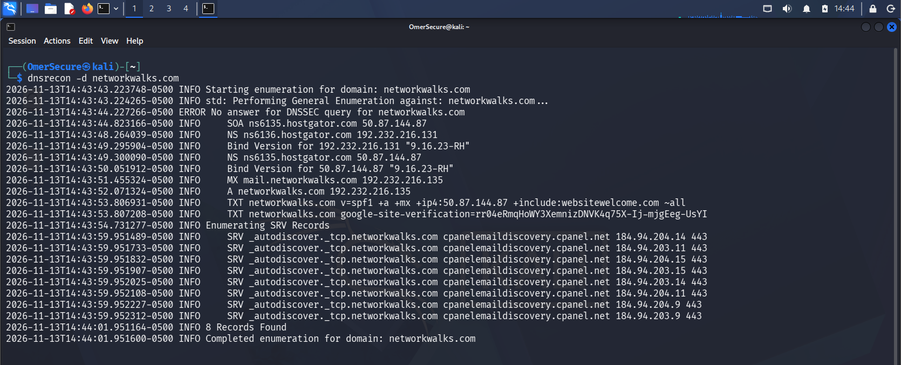
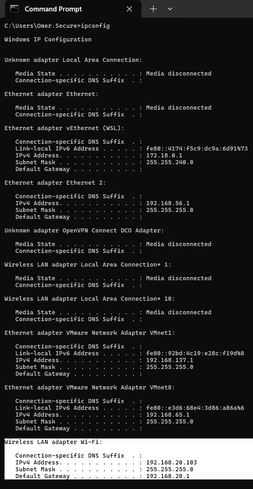
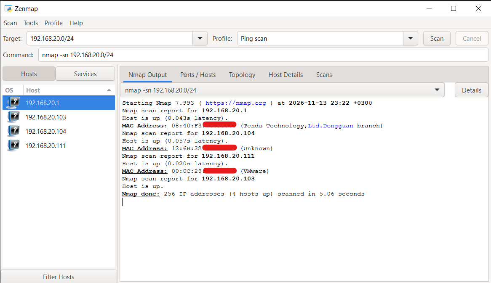
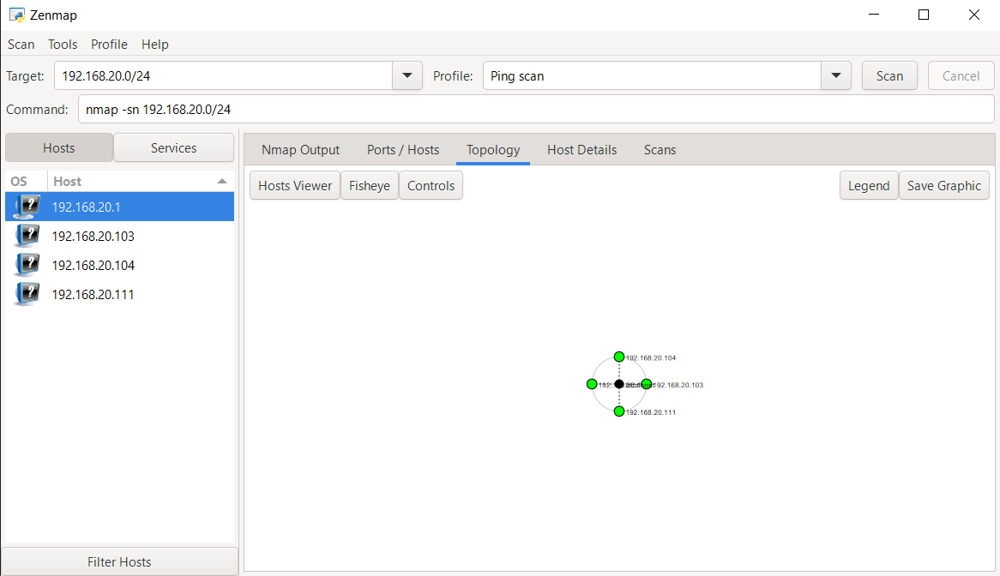

# Final Penetration Testing Report

<div align="center">
<h3>PENETRATION TESTING REPORT</h3>
<h3>FOOTPRINTING & NETWORK SCANNING PHASES</h3>
<p>W2-PM-FINAL | CYBERSECURITY | NETWORKWALKS</p>
</div>

| Field | Details |
| :---: | :---: |
| Pentester Name <br>(Cybersecurity Professional) | Omer Khalid Omer Ali Bawazir |
| Program/Batch | B084-Networkwalks |
| Date | 13 November 2026 |
| Modules completed | W2-PM1 (Multiple Kali Tools) <br>W2-PM5 (Zenmap Scanning) |
| Client/Target | 1. Networkwalks (secured written permission already) <br>2. My own local LAN Network |
| Permission secured from client? | Yes |
| Phases covered | Phase 1: Reconnaissance & Footprinting <br>Phase 2: Scanning & Network Discovery <br>Phase 3-5: In Progress |


## 1. Liability Disclaimer

I have performed these activities only on the systems and devices where I had secured written permission or the devices/systems that I own myself. All these materials are for education and research purposes only. Do not use anything from here to break the law. The instructor, the authors and Networkwalks are not responsible for what you do with this knowledge. Every action you take is your own responsibility. Misuse can lead to criminal charges, heavy fines, loss of your job and a permanent record. In most countries unauthorised access is a crime even when nothing is damaged.

## 2. Introduction

This report covers footprinting the networkwalks.com domain using multiple Kali Linux tools (W2-PM1) and scanning my own local network with Zenmap (W2-PM5). One module covers the footprinting phase and the other covers the scanning phase, so together they show how an attacker moves from gathering public information to mapping live hosts on a network. It is the Week 2 part of my ongoing internship program at Networkwalks.

All commands were run in Kali Linux for footprinting and on a Windows PC with Zenmap installed for scanning. Every step below includes the exact command used, the result I observed, evidence screenshots, and a short note on why the finding matters from an attacker’s point of view.

## 3. Tools Used

| Tool | Purpose |
|---|---|
| Kali Linux & Windows | Operating systems used for reconnaissance activities |
| WHOIS | Find domain registration details |
| WhatWeb | Fingerprint web technologies |
| Nslookup | Resolve the domain name to its IP address |
| curl -I | Read HTTP response headers |
| Wafw00f | Detect Web Application Firewall |
| DNSRecon | Enumerate DNS records |
| Zenmap (Nmap GUI) | Scan local subnet to find live hosts, IPs and MAC addresses |
| Windows CMD | Local IP and MAC address identification |

## 4. Activities Performed

### 4.1 Footprinting & Reconnaissance — W2-PM1

I performed reconnaissance against the networkwalks.com domain using six Kali Linux tools: WHOIS, WhatWeb, Nslookup, Curl, Wafw00f and DNSRecon.

#### 4.1.1 WHOIS

Command:
```bash
whois networkwalks.com
```

Observed result summary:
- Domain Name: NETWORKWALKS.COM
- Registrar: GoDaddy.com LLC
- Creation Date: 2019-11-06
- Registry Expiry Date: 2027-11-06
- Name Servers: NS6135.HOSTGATOR.COM, NS6136.HOSTGATOR.COM

Finding: The domain is registered through GoDaddy and hosted using HostGator name servers. This reveals hosting infrastructure information.

#### 4.1.2 WhatWeb

Command:
```bash
whatweb networkwalks.com
```

Observed result summary:
- Apache web server
- WordPress 7.1.4
- WP Download Manager 3.3.76
- jQuery 3.7.1
- IP address: 192.232.216.135
- Email exposed: info@networkwalks.com

Finding: Public technology fingerprinting exposed CMS and plugin version information.

#### 4.1.3 Nslookup

Command:
```bash
nslookup networkwalks.com
```

Observed result:
- Name: networkwalks.com
- Address: 192.232.216.135

Finding: The domain resolves to a public IP address that can be used for further authorized scanning.

#### 4.1.4 Curl -I

Command:
```bash
curl -I https://networkwalks.com
```

Observed result summary:
- HTTP/1.1 200 OK
- Server: Apache
- WordPress-related headers
- WordPress REST API endpoint `/wp-json/` exposed

Finding: HTTP headers provided additional technology and endpoint information.

#### 4.1.5 Wafw00f

Command:
```bash
wafw00f networkwalks.com
```

Observed result:
- The site is behind ModSecurity (SpiderLabs) WAF.

Finding: A Web Application Firewall is present, which is a positive security control.

#### 4.1.6 DNSRecon

Command:
```bash
dnsrecon -d networkwalks.com
```

Observed result summary:
- Name servers: hostgator
- DNS software: Bind Version "9.16.23-RH"
- Mail-related records
- SPF/TXT records
- cPanel service records

Finding: DNS enumeration provided a broader view of the target’s DNS and mail infrastructure.

---

### 4.2 Network Scanning with Zenmap — W2-PM5

I used Zenmap to perform network discovery on my local network.

#### 4.2.1 Task 2: Local IP and LAN subnet

Command:
```cmd
ipconfig
```

Observed result:
- Local IP address: `192.168.20.103`
- Subnet mask: `255.255.255.0` --> `192.168.20.0/24`

#### 4.2.2 Task 3: Find live hosts

Zenmap settings:
- Target: `192.168.20.0/24`
- Profile: `Ping scan`
- Command: `nmap -sn 192.168.20.0/24`

Observed example result:
- 4 live hosts found
- Scan completed in 5.06 seconds

#### 4.2.3 Task 4: How many hosts are live in your subnet?

Answer: **4 hosts are live, including my PC**.

#### 4.2.4 Task 5: IP addresses of live hosts

Example result:
- 192.168.20.1
- 192.168.20.103
- 192.168.20.104
- 192.168.20.111

#### 4.2.5 Task 6: MAC addresses of live hosts

Example result:

| IP Address | MAC Address |
| :---: | :---: |
| 192.168.20.1 | 08:40:F3:xx:xx:xx |
| 192.168.20.104 | 12:6B:32:xx:xx:xx |
| 192.168.20.111 | 00:0C:29:xx:xx:xx |
| 192.168.20.103 | xx:xx:xx:xx:xx:xx — local MAC from `ipconfig /all`|

#### 4.2.6 Task 7: Display and save output topology in PDF

Steps performed:
1. Opened Zenmap.
2. Ran Ping Scan on the local subnet.
3. Clicked **Topology**.
4. Turned on **Legend**.
5. Clicked **Save Graphic**.
6. Selected **PDF**.
7. Saved the file to Desktop as `Network-Topology.pdf`.

## 5. Risk Analysis / Impact

| # | Risk / Finding | Evidence / Observation | Potential Impact | Risk Level |
|:---:|:---:|:---:|:---:|:---:|
| 1 | Web technology information exposed | WhatWeb identified WordPress and WP Download Manager | Attackers may use version information to identify software requiring review | Medium |
| 2 | Server IP address identifiable | Nslookup resolved domain to 192.232.216.135 | Provides network location information | Low |
| 3 | HTTP technical information exposed | Curl exposed headers and `/wp-json/` | Assists technology fingerprinting and enumeration | Low |
| 4 | WAF technology identifiable | Wafw00f identified ModSecurity | Reveals security architecture information | Low |
| 5 | DNS infrastructure information exposed | DNSRecon found DNS, mail and service records | Helps build broader infrastructure profile | Medium |
| 6 | Multiple live hosts visible on local network | Zenmap identified four live hosts in example scan | Unknown devices may be present on a network | Medium |

The risks above are observations from footprinting and scanning exercises, not confirmed vulnerabilities. No exploitation or vulnerability validation was performed in these modules.

## 6. Recommendations

1. Review publicly exposed technology information regularly.
2. Keep CMS platforms, plugins and web technologies updated.
3. Review HTTP response headers to reduce unnecessary information exposure.
4. Review DNS records periodically and expose only required services.
5. Keep the WAF enabled and properly tuned.
6. Perform regular internal network discovery.
7. Investigate any unexpected device discovered during scanning.
8. Maintain network topology and device documentation.
9. Perform reconnaissance and scanning only with proper authorization.

## 7. Conclusion

During Week 2 of my Cybersecurity & Ethical Hacking internship, I completed practical activities covering footprinting, reconnaissance and network scanning.

In the footprinting activity, I used six Kali Linux tools to collect information about the target domain. I learned how WHOIS provides domain registration information, WhatWeb identifies web technologies, Nslookup resolves domain names, Curl inspects HTTP headers, Wafw00f identifies a WAF, and DNSRecon provides additional DNS information.

In the network scanning activity, I used Zenmap to identify my local network configuration and discover active hosts. I collected IP and MAC address information and created a network topology.

The exercises showed me that information gathering is an important part of cybersecurity. Technical findings should be documented clearly, including what was performed, what was discovered, the potential risk, and recommended mitigation. All reconnaissance and scanning activities were completed within the authorized scope of the assigned educational lab.

## 8. Evidences Collected

Attach the following screenshots and files:

## Screenshots

* **1- Whois:**
  

* **2- WhatWeb:**
  

* **3- Nslookup:**
  

* **4- Curl:**
  

* **5- WafW00f:**
  

* **6- DNSRecon:**
  

* **7.1- IPConfig:**
  

* **7.2 Zenmap PingScan:**
  

* **7.3 Zenmap Topology:**
  

---
